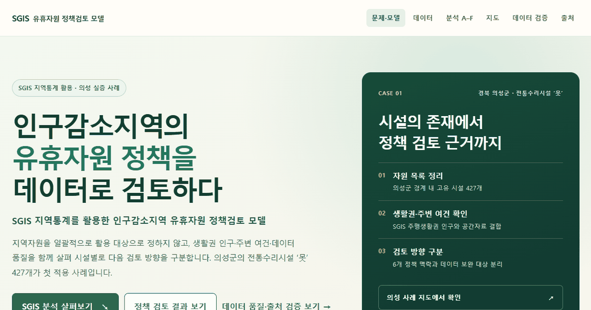

<div align="center">

<a href="https://ssoyoum.github.io/Uiseong-Resource-Model/"></a>

# SGIS 지역통계를 활용한<br>인구감소지역 유휴자원 정책검토 모델

**시설이 '있다'는 사실에서, 정책을 '검토할 근거'까지**

SGIS 주행생활권 인구를 지역자원에 연결해 시설별 정책 검토 근거를 만듭니다.<br>
첫 적용 사례는 경북 의성군의 전통수리시설 **'못' 427개**입니다.

[](https://ssoyoum.github.io/Uiseong-Resource-Model/)
[](https://github.com/ssoyoum/Uiseong-Resource-Model/actions/workflows/pages.yml)
[](requirements.txt)

[**공개 Web GIS**](https://ssoyoum.github.io/Uiseong-Resource-Model/) ·
[SGIS 인구 비교](https://ssoyoum.github.io/Uiseong-Resource-Model/#analysis-d) ·
[정책 검토 결과](https://ssoyoum.github.io/Uiseong-Resource-Model/#analysis-e) ·
[데이터 검증](https://ssoyoum.github.io/Uiseong-Resource-Model/#quality)

</div>

---

## 📊 한눈에 보기

<div align="center">

| 🗺️ 분석 대상 못 | 📍 좌표 조건 통과 | 🚗 SGIS 10분 인구 확보 | 🏢 VWorld 주변시설 | 🧭 정책 검토 맥락 |
| :---: | :---: | :---: | :---: | :---: |
| **427개** | **380개** | **190개** | **68개** | **6개** |
| 의성군 경계 내 고유 시설 ID | SGIS 분석용 좌표 조건 | 5분·10분 모두 175개 | UQ164·UO601 | 상호배타적 분류 |

</div>

> 2025년 의성 청년연구자 활동에서 정리한 못 자료와 정책 제안을 출발점으로, SGIS 지역통계를 더해 **시설별 근거**와 **데이터 보완 대상**을 구분했습니다.

## 🔄 모델의 흐름


자세한 방법은 [분석 방법](docs/sgis-catchment-analysis.md)과 [정책 검토 기준](docs/sgis-policy-comparison.md)에 정리했습니다.

## 🧭 의성 사례의 검증 결과

전체 427개 못은 시설마다 하나의 **정책 검토 맥락**만 갖습니다. SGIS 기준연도는 **2024년**입니다.

| 정책 검토 맥락 | 시설 수 | 의미 |
| :--- | ---: | :--- |
| 🟢 접근·도달 검토 | **20** | SGIS 10분 도달인구 또는 5→10분 증가폭 상위 사분위 |
| 🟡 청년참여 검토 | **43** | 읍·면 청년비율 상위 맥락 + SGIS 10분 응답 |
| 🔵 공동체 지원 검토 | **53** | 읍·면 고령비율 상위 + VWorld 매핑시설 없음 |
| 🟠 현장 확인 필요 | **47** | 현재 공간·인구 근거만으로 방향을 정하지 않음 |
| ⚪ 맥락 참고 | **74** | 위 세 검토 규칙에 해당하지 않아 맥락 정보만 제공 |
| ⬜ SGIS 10분 인구 미확보 | **190** | 데이터 보완 대상 (0명으로 대체하지 않음) |

접근·도달·청년참여·공동체 지원 맥락 **116개**에는 현장검토 양식을 만들었습니다.
→ [시설별 근거표](data/analysis/sgis_policy_evidence.csv) · [현장검토 양식](data/analysis/policy_candidate_review_template.csv)

> [!IMPORTANT]
> - SGIS 미응답은 인구 **0명으로 바꾸지 않았습니다.**
> - 생활권 인구는 **실제 방문객 수가 아닙니다.**
> - 정책 검토 맥락은 정책 채택이나 효과 검증 결과가 아니며, 가중치·점수·자동 추천을 쓰지 않습니다.
> - 타 지역 적용은 후속 검증 대상입니다.

## 🛡️ 데이터 품질과 출처

파이프라인을 실행할 때마다 다음 항목을 자동 점검합니다. → [품질 점검 결과](data/analysis/data_quality_audit.json) · [검증 보고서](data/analysis/validation_report.json)

- ✅ 인구 합계 일치 (읍·면 합 = 원자료 군 총계)
- ✅ SGIS 응답 중복, 0명 대체 여부
- ✅ Buffer 값의 일관성, 원자료 SHA-256 변화
- ✅ 핵심 수치(427·380·190 등) 고정 여부
- ✅ 좌표계(EPSG:5174)·geometry 유효성·의성군 경계 포함 여부

| 자료 | 제공 | 기준연도 | 쓰임 | 출처 기록 |
| :--- | :--- | :---: | :--- | :--- |
| 생활권역 통계 (주행 5분·10분) | SGIS | 2024 | 시설별 생활권 인구 | [sgis_sources.csv](data/manifests/sgis_sources.csv) |
| 주민등록 연령별 인구 | 행정안전부 | 2024·2025 | 18개 읍·면 청년·고령 구조 | [population_sources.csv](data/manifests/population_sources.csv) |
| 도로 UQ151 | 국토교통부 (VWorld) | — | 도로까지 **직선거리** | [vworld_sources.csv](data/manifests/vworld_sources.csv) |
| 생활편의시설 UQ164 · UO601 | 국토교통부 (VWorld) | 2026 | 주변시설 68개 | [vworld_sources.csv](data/manifests/vworld_sources.csv) |
| WorldPop 100m | Univ. of Southampton | 2020 | **참고자료** (공식 인구격자 아님) | [source_manifest.csv](data/manifests/source_manifest.csv) |

- 모든 자료의 제공기관·기준연도·이용조건은 [출처 목록](data/manifests/source_manifest.csv) 하나에 모았고, 확인되지 않은 값은 `DATA_NOT_AVAILABLE`로 남깁니다.
- VWorld 자료는 CC BY-NC-ND 조건입니다. 전국 원자료는 저장소에 올리지 않고, 분석 재현용 의성군 추출본만 둡니다.
- 좌표 보완 후보(SGIS 지번 지오코딩), 가중치 민감도, WorldPop 참고 인구는 본 결과와 분리한 검토·참고 자료입니다.

## 🚀 실행 방법

```powershell
pip install -r requirements.txt                 # Python 3.12에서 검증
python analysis/acquire_population.py           # 행정안전부 주민등록 인구
python analysis/acquire_worldpop.py             # WorldPop 참고격자
# VWorld UQ151·UQ164·UO601은 로그인 후 내려받아 vworld/에 저장
python analysis/run_competition_pipeline.py     # 마지막 줄 pipeline complete: PASS
python analysis/build_public_site.py --output _site
python -m http.server 8000 --bind 127.0.0.1 --directory _site
```

<details>
<summary><b>SGIS 재조회 · 배포 안내</b></summary>
<br>

- SGIS 생활권을 다시 조회하려면 `.env.example`을 `.env`로 복사해 인증키를 넣습니다.
- 공개 사이트는 `main`에 push할 때 Python 문법 검사와 웹 화면 테스트(`tests/`)를 통과해야 배포됩니다.

</details>

<details>
<summary><b>저장소 구조</b></summary>
<br>

```text
Uiseong-Resource-Model/
├─ analysis/          # 수집·전처리·분석·검증 파이프라인 (Python)
│  └─ figures/        # 자동 생성 그림
├─ data/
│  ├─ analysis/       # 분석 결과 (CSV·JSON)
│  ├─ geojson/        # Web GIS 레이어
│  └─ manifests/      # 데이터 출처 기록
├─ docs/              # 방법론·검증·정책 검토 문서
├─ tests/             # 웹 화면·제출 검증 테스트
└─ index.html         # 공개 Web GIS
```

</details>

---

<div align="center">
<sub>경북 의성군 사례 · 데이터 출처: SGIS, 행정안전부, 국토교통부(VWorld), WorldPop</sub>
</div>
