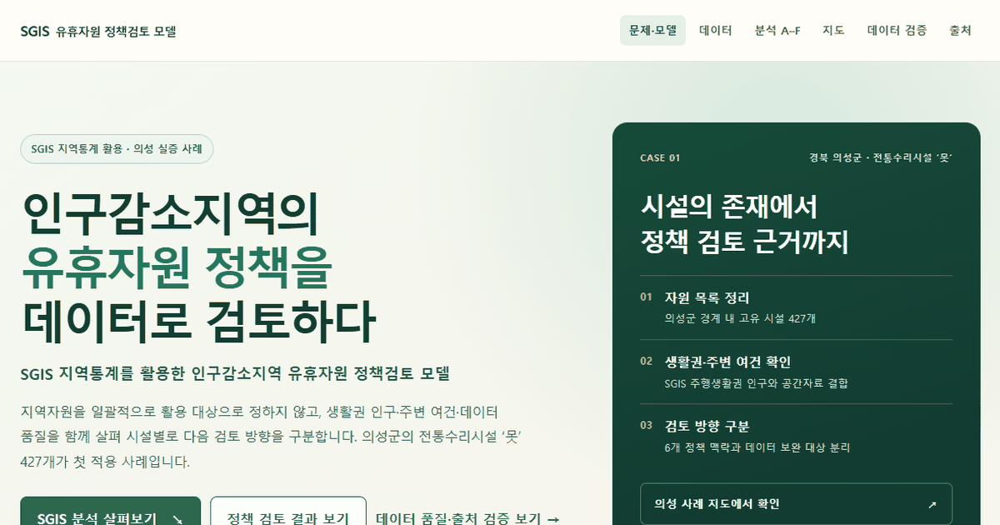
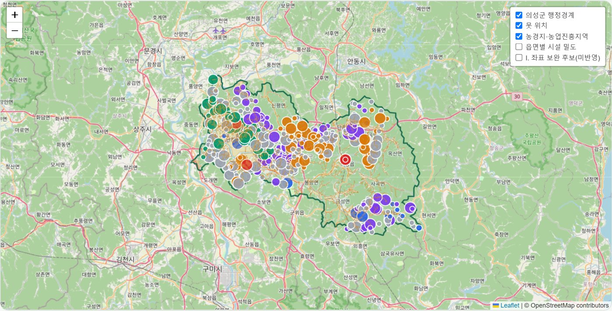
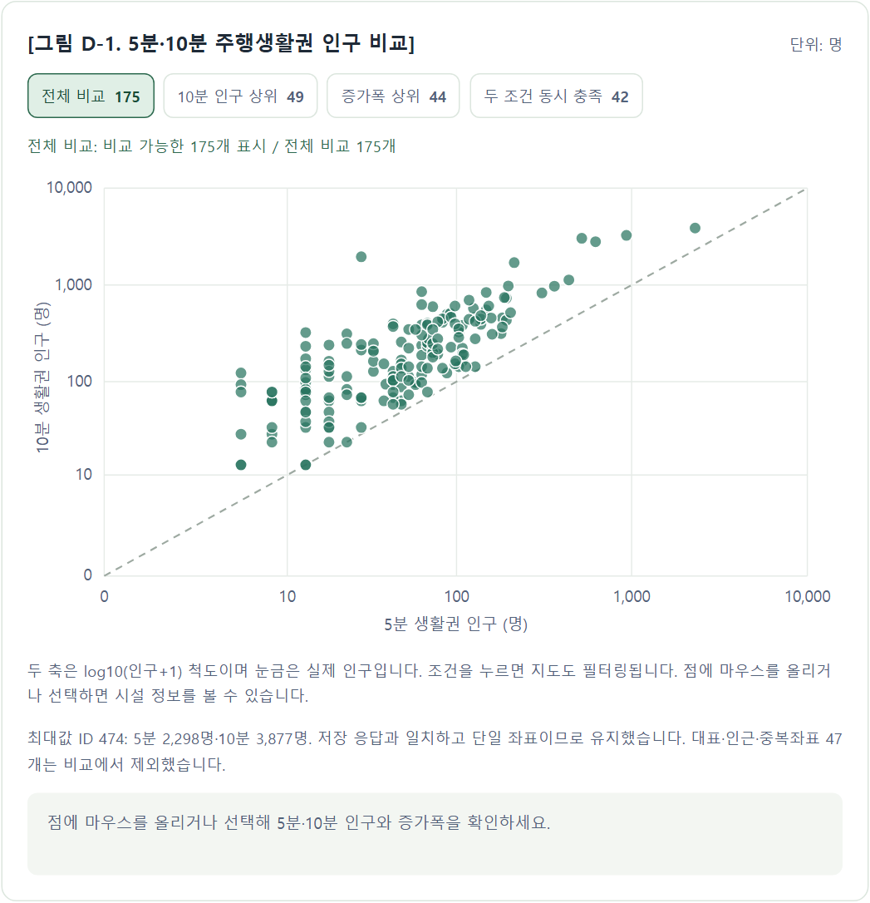
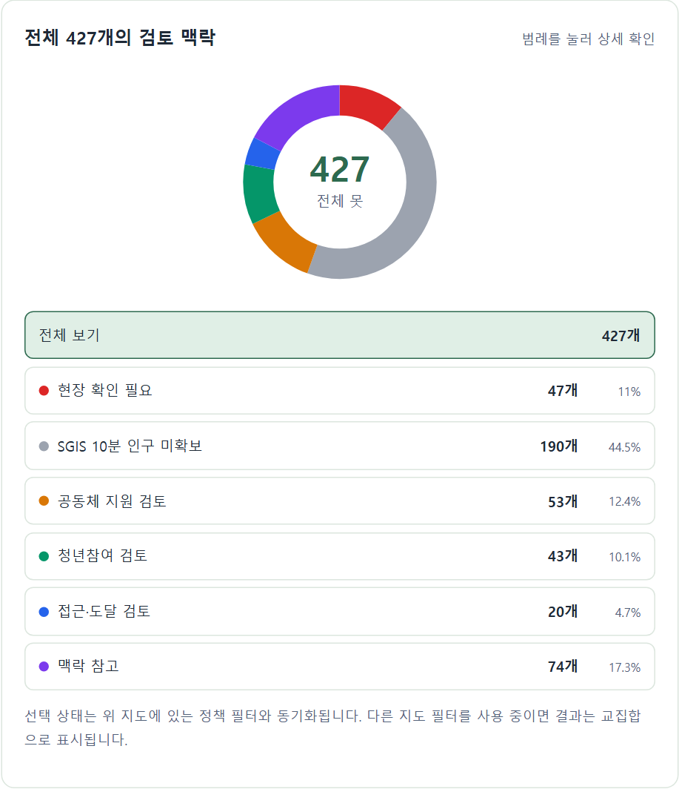
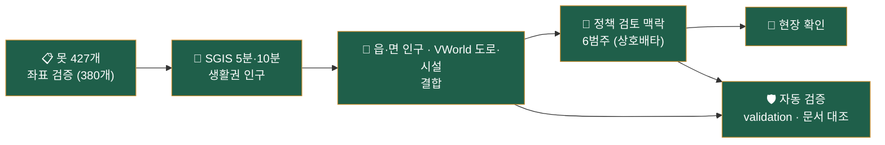

<div align="center">

<a href="https://ssoyoum.github.io/Uiseong-Resource-Model/"></a>

# SGIS 지역통계를 활용한<br>인구감소지역 유휴자원 정책검토 모델

**시설이 '있다'는 사실에서, 정책을 '검토할 근거'까지**

SGIS 주행생활권 인구를 지역자원에 연결해 시설별 정책 검토 근거를 만듭니다.<br>
첫 적용 사례는 경북 의성군의 전통수리시설 **'못' 427개**입니다.

<br>

<a href="https://ssoyoum.github.io/Uiseong-Resource-Model/"></a>

### 🔗 [ssoyoum.github.io/Uiseong-Resource-Model](https://ssoyoum.github.io/Uiseong-Resource-Model/)

[SGIS 인구 비교](https://ssoyoum.github.io/Uiseong-Resource-Model/#analysis-d) ·
[정책 검토 결과](https://ssoyoum.github.io/Uiseong-Resource-Model/#analysis-e) ·
[데이터 검증](https://ssoyoum.github.io/Uiseong-Resource-Model/#quality)

<br>

[](https://github.com/ssoyoum/Uiseong-Resource-Model/actions/workflows/pages.yml)
[](requirements.txt)

</div>

---

## 무엇을 만들었나

| | |
| --- | --- |
| **문제** | 인구감소지역에는 쓰임이 줄어든 지역자원이 많지만, 시설을 일괄로 «활용 대상»이라 하면 정책 근거가 되지 못합니다. 의성군 전통수리시설 '못'은 427개이고, 시설마다 주변 생활권 인구와 여건이 다릅니다. |
| **해결** | SGIS 주행생활권(5분·10분) 인구를 시설별로 연결하고, 읍·면 청년·고령 구조, VWorld 도로·생활시설을 더해 시설마다 하나의 **정책 검토 맥락**을 붙입니다. 값이 없는 시설은 0명으로 채우지 않고 «데이터 보완 대상»으로 분리합니다. |
| **규모** | 시설 427개 · 18개 읍·면 · SGIS 10분 인구 확보 190개 · VWorld 주변시설 68개 · 도로 최근접거리 427개 |
| **개발** | 1인 개발 · 2026-08-18 ~ 2026-10-16 · 커밋 94개 · 자료 수집·전처리·분석·검증 파이프라인(Python)과 Web GIS 전부 |
| **공개** | GitHub Pages 정적 Web GIS (push마다 자동 배포) |

> 2025년 의성 청년연구자 활동에서 정리한 못 자료와 정책 제안이 출발점입니다.

## 화면

<table>
  <tr>
    <td colspan="2" align="center">
      <b>Web GIS</b> · 427개 시설 지도<br>
      <br>
      <sub>정책 검토 맥락·활용유형·읍·면·용량으로 필터링하고, 시설을 눌러 근거를 봅니다.</sub>
    </td>
  </tr>
  <tr>
    <td width="50%" align="center" valign="top">
      <b>분석 D</b> · 생활권 인구<br>
      <br>
      <sub>5분·10분 모두 응답한 175개 시설의 인구 비교. 미응답은 그래프에서 제외합니다.</sub>
    </td>
    <td width="50%" align="center" valign="top">
      <b>분석 E</b> · 정책 검토 맥락<br>
      <br>
      <sub>모든 시설이 맥락 하나에만 속하며, 지도 필터와 동기화됩니다.</sub>
    </td>
  </tr>
</table>

## 기술적 도전과 해결

**1. 427개 중 380개만 SGIS 분석에 쓸 수 있었습니다**
시설 좌표를 점검하니 고유 좌표는 386개였고, 중복 좌표에 묶인 시설이 43개, 인근 좌표 시설이 4개였습니다. 시군구 대표점이거나 같은 좌표를 공유하는 시설은 개별 위치로 볼 수 없어 순위·상관·읍·면 요약에서 빼고, 검증된 380개만 분석했습니다. 제외한 응답값은 원자료 대조용으로 CSV에 남겼습니다. → [좌표 감사표](data/analysis/coordinate_quality_audit.csv)

**2. 응답이 없는 값을 0명으로 만들지 않았습니다**
검증 좌표 380개 중 SGIS 10분 인구를 받은 곳은 190개입니다. 미응답은 SGIS가 위치를 인식하지 못한 경우와 생활권은 만들었으나 통계값을 돌려주지 않은 경우로 나뉘었습니다. 둘 다 `DATA_NOT_AVAILABLE`로 두고 정책 맥락에서도 «SGIS 10분 인구 미확보 190개»를 별도 범주로 세웠습니다. 인구가 없는 시설이 «수요 없음»으로 읽히는 것을 막기 위해서입니다.

**3. 정의가 다른 인구를 합치지 않았습니다**
읍·면 주민등록 인구, SGIS 주행생활권 인구, WorldPop 격자는 기준시점과 범위가 다릅니다. 5분·10분 생활권은 시설끼리 겹치기도 합니다. 그래서 시설 간 합산은 하지 않고 시설별 도달 규모 비교에만 쓰며, WorldPop은 공식 인구격자가 아닌 별도 참고자료로 분리했습니다.

**4. 점수·예측 모델을 쓰지 않기로 했습니다**
규칙기반 활용유형을 표본 검토해 보니 427개 중 329개(77.0%)가 보존·기록형 fallback으로 분류됐고, 공동체형·관리우선형은 0건이었습니다. 정답 라벨이 없는 상태에서 머신러닝이나 가중치 점수를 얹으면 근거 없는 정밀도가 생기므로, 정책 맥락은 분위수 기준의 설명 가능한 규칙으로만 나누고 자동 추천은 하지 않았습니다. → [분류 사유 검토](docs/classification-reason-review.md)

**5. 수치가 문서와 어긋나지 않게 자동 검증합니다**
파이프라인을 돌릴 때 `validation_report`(16 PASS / 0 FAIL: 인구 합계 일치, 0명 대체 여부, 좌표계, geometry 유효성 등)와 제출 문서 대조(65 PASS / 0 FAIL: 핵심 수치·파일 경로·출처)를 함께 실행합니다. → [검증 보고서](data/analysis/validation_report.json) · [문서 대조 보고서](data/analysis/submission_claims_report.json)

## 정책 검토 결과 (의성 사례)

| 정책 검토 맥락 | 시설 수 | 의미 |
| :--- | ---: | :--- |
| 🔵 접근·도달 검토 | **20** | SGIS 10분 도달인구 또는 5→10분 증가폭이 상위 사분위 |
| 🟢 청년참여 검토 | **43** | 읍·면 청년비율 상위 + SGIS 10분 응답 |
| 🟠 공동체 지원 검토 | **53** | 읍·면 고령비율 상위 + VWorld 매핑시설 없음 |
| 🔴 현장 확인 필요 | **47** | 현재 공간·인구 근거만으로 방향을 정하지 않음 |
| 🟣 맥락 참고 | **74** | 위 규칙에 해당하지 않아 맥락 정보만 제공 |
| ⚪ SGIS 10분 인구 미확보 | **190** | 데이터 보완 대상 |

→ [시설별 근거표](data/analysis/sgis_policy_evidence.csv) · [현장검토 양식](data/analysis/policy_candidate_review_template.csv) · [정책 검토 기준](docs/sgis-policy-comparison.md)

## 구조



| 영역 | 기술 | 선택 이유 |
| --- | --- | --- |
| 분석 | Python · pandas · GeoPandas · Shapely | 좌표·도로·시설을 EPSG:5174 미터 좌표로 맞춰 거리와 Buffer를 계산 |
| 자료 | SGIS API · 행정안전부 · VWorld · WorldPop | 출처별 제공기관·기준연도·이용조건을 [출처 목록](data/manifests/source_manifest.csv)에 기록 |
| 화면 | 정적 HTML/JS · Leaflet | 서버 없이 GitHub Pages로 공개하고, 분석 결과를 GeoJSON·CSV 그대로 읽음 |
| 검증 | 파이프라인 validation · `node --test` · pytest | 수치·경로·출처 불일치를 배포 전에 걸러냄 |
| 배포 | GitHub Actions · GitHub Pages | main에 push하면 자동 배포 |

| 자료 | 제공 | 기준연도 | 쓰임 |
| :--- | :--- | :---: | :--- |
| 생활권역 통계 (주행 5분·10분) | SGIS | 2024 | 시설별 생활권 인구 |
| 주민등록 연령별 인구 | 행정안전부 | 2024·2025 | 18개 읍·면 청년·고령 구조 |
| 도로 UQ151 | 국토교통부 (VWorld) | — | 도로까지 **직선거리** (네트워크 거리 아님) |
| 생활편의시설 UQ164 · UO601 | 국토교통부 (VWorld) | 2026 | 주변시설 68개 |
| WorldPop 100m | Univ. of Southampton | 2020 | **참고자료** (공식 인구격자 아님) |

VWorld 자료는 CC BY-NC-ND 조건이라 전국 원자료는 저장소에 올리지 않고, 재현용 의성군 추출본만 둡니다.

## 실행

```powershell
pip install -r requirements.txt     # Python 3.12 기준
python analysis/run_competition_pipeline.py
```

원자료(VWorld 등)는 [출처 목록](data/manifests/source_manifest.csv)에 적힌 경로에 직접 내려받아 둬야 합니다. 공개 화면은 별도 실행 없이 위 링크에서 볼 수 있습니다.

## 한계

- **생활권 인구는 실제 방문객 수가 아닙니다.** 같은 이동시간 조건에서 인구 규모를 비교하는 값입니다.
- **정책 검토 맥락은 정책 채택이나 효과의 검증 결과가 아닙니다.** 현장 관리상태·보존가치 조사로 이어지는 첫 선별입니다.
- SGIS 10분 인구는 427개 중 190개만 확보됐습니다. 좌표 보정 자료가 확보되면 재수집할 예정이며, 보정 전에는 결과를 바꾸지 않았습니다.
- 국내 공식 인구격자는 확보하지 못해 500m·1km 인구는 산출하지 않았습니다.
- 도로 접근성은 직선거리입니다.
- 의성군 한 곳에서만 검증했고, 타 지역 적용은 후속 과제입니다.

---

<div align="center">
<sub>경북 의성군 사례 · 데이터 출처: SGIS, 행정안전부, 국토교통부(VWorld), WorldPop</sub>
</div>
